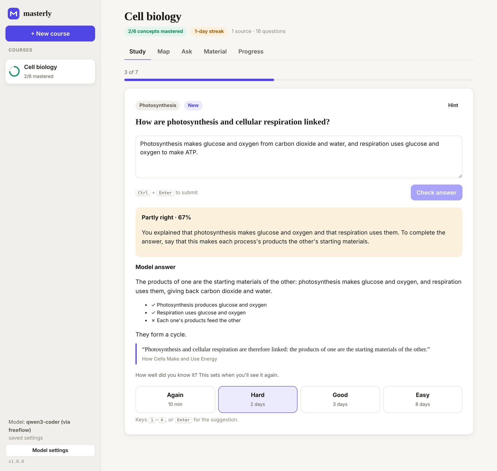
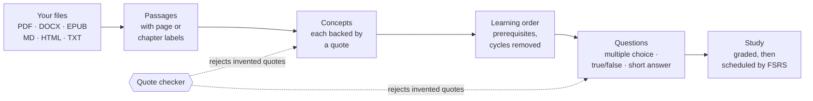
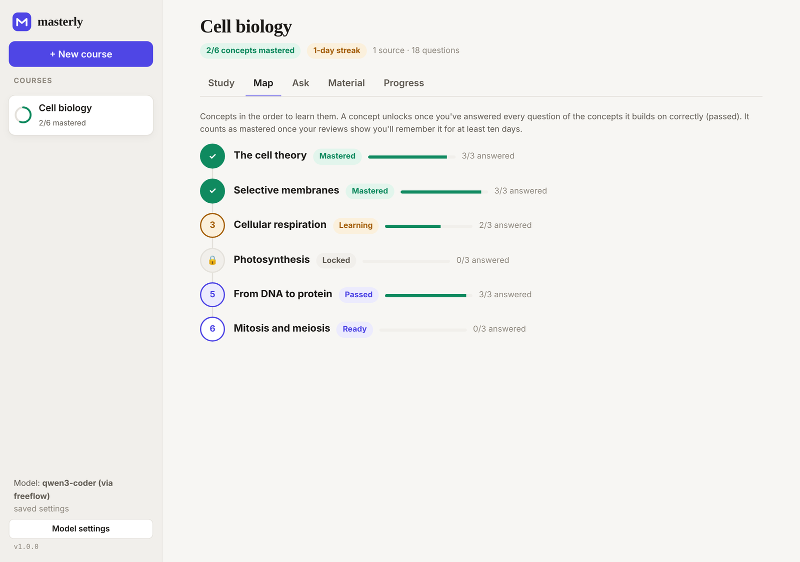
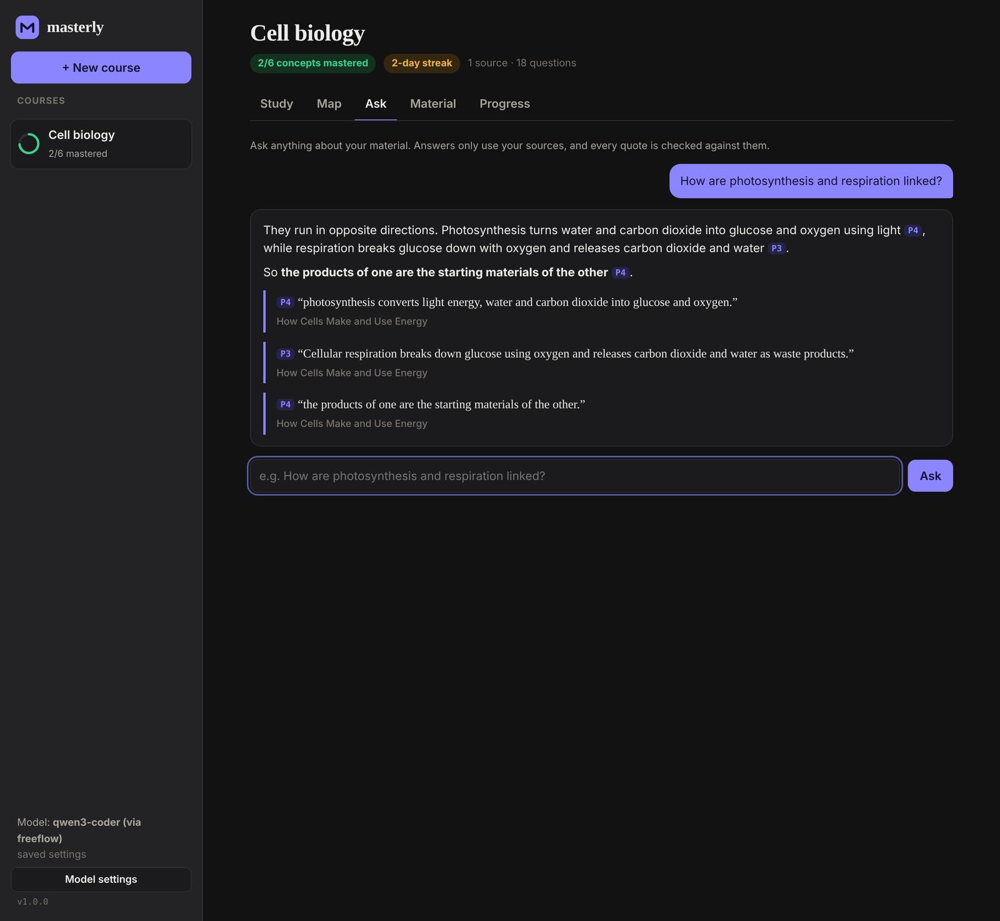
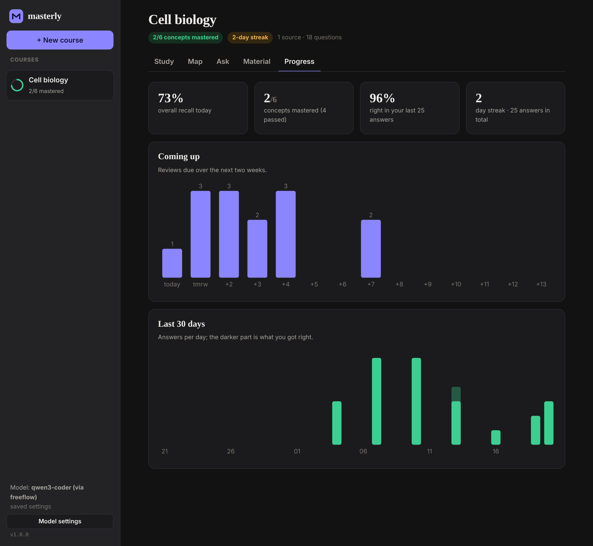
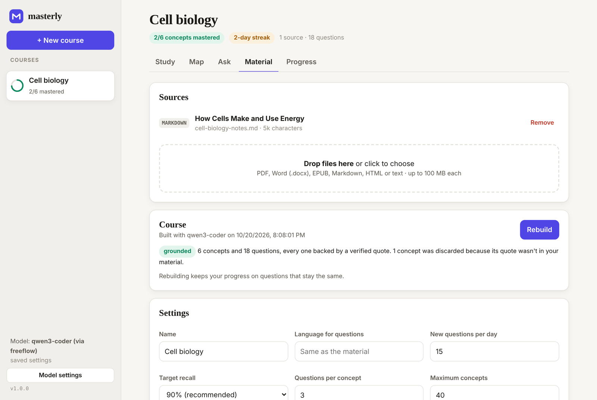

<div align="center">


# masterly

**Learn anything from your own material.**

masterly turns your notes, textbooks and papers into a course: the key concepts in the order to learn them,
practice questions that quote your sources word for word (checked by code, not trusted to the model),
and reviews scheduled with FSRS so that what you learn stays learned.

[](https://github.com/Ethos6/masterly/actions/workflows/ci.yml)
[](LICENSE)


[Quick start](#quick-start) · [How it works](#how-it-works) · [Grounding](#what-grounded-means) · [Models](#choosing-a-model) · [CLI](#command-line) · [Privacy](#privacy-and-security)



<sub>A sample course built from the notes in <a href="test/fixtures/biology.md">test/fixtures/biology.md</a>.</sub>

</div>

## Why masterly

AI tutors are good at sounding right. When they are wrong, a learner has no way to tell, and confidently wrong practice questions teach the wrong thing. masterly is built around three rules:

- **Every fact comes from your material, and the code checks it.** Each concept, question and answer must quote the passage it relies on, and masterly verifies that the quote really is in your files before you ever see it. Anything that fails is thrown away. Answers in Ask mode show their sources, and unverifiable claims are flagged.
- **Learn in the right order.** masterly works out which concepts build on which, and only opens a concept once you've passed the ones it depends on. You see the whole path on the Map.
- **Remember it next month.** Reviews are scheduled with [FSRS-6](https://github.com/open-spaced-repetition/fsrs4anki/wiki/The-Algorithm), the model behind modern Anki, cross-checked in CI against the reference implementation. A concept only counts as *mastered* when your reviews show you'll still remember it in ten days.

And it stays out of your way: one install command, a clean local web app, your data in plain JSON files on your own machine, and any model you like, including free and fully local ones.

## Quick start

You need [Node.js 22 or newer](https://nodejs.org).

```bash
npm install -g github:Ethos6/masterly
masterly
```

The app opens in your browser:

1. **Connect a model** (see [Choosing a model](#choosing-a-model)). If [freeflow](https://github.com/Ethos6/freeflow) or Ollama is running, masterly finds it by itself.
2. **Create a course** and drop in your material: PDF, Word, EPUB, Markdown, HTML or plain text.
3. **Build** it. masterly reads everything, finds the concepts, orders them and writes questions. A textbook chapter takes a minute or two.
4. **Study.** Ten minutes a day is enough. masterly brings back what you're about to forget and introduces new concepts as you're ready for them.

Prefer the terminal?

```bash
masterly new "Cell biology" notes/ chapter-3.pdf    # create, add a folder and a file, build
masterly study "Cell biology"                        # study in the terminal
```

## How it works



1. **Read.** Text is extracted with page numbers for PDFs and chapters for EPUBs, then split into passages that never cross a page or chapter.
2. **Find concepts.** The model reads the material in batches and proposes the ideas a learner must master, each with a supporting quote. Unsupported concepts are dropped; duplicates found in different parts are merged.
3. **Order them.** Prerequisites are collected and any cycles are broken by dropping the least plausible edge (a concept that depends on something introduced later). The result is a learning path.
4. **Write questions.** For each concept, the model writes a mix of multiple-choice, true/false and short-answer questions from that concept's passages only. Each question must quote the text that proves its answer. Questions with invented quotes, duplicate options or impossible answers are rejected; if too few survive, the model gets one more try.
5. **Study.** Choice questions are graded by code. Short answers are graded by the model against key points taken from your material, with specific feedback. You confirm or adjust the suggested rating (Again, Hard, Good, Easy) and FSRS schedules the next review.

Rebuilding after you add material keeps your progress on every question that stays the same.

## What "grounded" means

A quote passes only if it appears in the passage the model was shown. Matching ignores differences that don't change meaning (case, spacing and line breaks, curly vs straight quotes, dash styles, Markdown emphasis, Unicode forms such as decomposed accents) but never accepts paraphrase. A quote may skip words with "…", as long as every piece appears, in order, in the same passage. Quotes shorter than three words don't count as evidence.

What it guarantees: **every question, concept and cited answer points to text that really is in your material**, and you can always see that text.
What it can't guarantee: that the model drew the right conclusion from a real quote. That's why the quote is always shown next to the answer, so you can judge for yourself.

## Screenshots

<table>
<tr>
<td width="50%"><br><sub><b>Map.</b> Concepts in learning order; later ones unlock as you pass their prerequisites.</sub></td>
<td width="50%"><br><sub><b>Ask.</b> Answers from your material only, with every quote checked.</sub></td>
</tr>
<tr>
<td width="50%"><br><sub><b>Progress.</b> What's due, what you've mastered, how you're doing.</sub></td>
<td width="50%"><br><sub><b>Material.</b> Sources, build status and settings, including how much was discarded as ungrounded.</sub></td>
</tr>
</table>

## Choosing a model

masterly works with any OpenAI-compatible Chat Completions endpoint. It looks for one in this order:

1. what you saved in **Model settings** (or `masterly model --base … --model … --key …`);
2. the environment: `MASTERLY_BASE_URL`, `MASTERLY_MODEL`, `MASTERLY_API_KEY` (or `OPENAI_BASE_URL`, `OPENAI_MODEL`, `OPENAI_API_KEY`);
3. a running [freeflow](https://github.com/Ethos6/freeflow) gateway on `127.0.0.1:4141`, which gives masterly 58 providers with automatic fallback, free tiers included;
4. a running [Ollama](https://ollama.com) on `127.0.0.1:11434`, fully offline.

| Setup | Base URL | Model, for example |
| --- | --- | --- |
| freeflow | `http://127.0.0.1:4141/v1` | `default` |
| Ollama | `http://127.0.0.1:11434/v1` | `qwen3:14b` |
| Groq | `https://api.groq.com/openai/v1` | `llama-3.3-70b-versatile` |
| OpenRouter | `https://openrouter.ai/api/v1` | any model id |
| OpenAI | `https://api.openai.com/v1` | any chat model |

Larger models write better questions and follow the quoting rules more reliably; small local models work, and more of their output is rejected by the quote checker, which you can see on the Material tab. masterly asks for JSON mode where the provider supports it, repairs common formatting slips, and retries politely on rate limits.

## Command line

```text
masterly                                  open the app in your browser
masterly new "Name" <files|folders>       create a course and build it
masterly add <course> <files|folders>     add material (then: masterly build <course>)
masterly build <course>                   find concepts and write grounded questions
masterly study <course> [--limit 20]      study in the terminal
masterly map <course>                     concepts in learning order, with your progress
masterly ask <course> "question"          answer from your material, with checked quotes
masterly export <course> --anki f.txt     every question as an Anki deck (File → Import)
masterly export <course> --guide f.md     a Markdown study guide with source quotes
masterly list                             your courses
masterly model [--base URL --model NAME --key KEY] [--test]
```

A course can be named by its full name or the start of its id.

## Privacy and security

- **Your data stays on your machine.** Courses live in `~/.masterly` (or `$MASTERLY_HOME`) as plain JSON, written atomically. The only thing that leaves is the text sent to the model you chose; with Ollama, nothing leaves at all.
- **The app only listens on `127.0.0.1`**, refuses requests addressed to any other host name (which blocks DNS-rebinding attacks), and only accepts changes from its own page (a custom header and same-origin check stop other websites from acting on your behalf).
- **Your API key never reaches the browser**; the page only learns whether one is saved.
- **Everything shown is escaped**, including model output and document text, and the page runs under a strict Content-Security-Policy.
- **Uploads are bounded**: 100 MB per file, at most 20 million characters of text, and protection against zip bombs in DOCX and EPUB files.

Found a problem? See [SECURITY.md](SECURITY.md).

## Testing

- `npm test`: 39 unit and integration tests. FSRS is checked against the reference [`ts-fsrs`](https://github.com/open-spaced-repetition/ts-fsrs) implementation over 3,000 random reviews (stability, difficulty and intervals). Grounding, extraction of real PDF/DOCX/EPUB files built in the tests, the build pipeline, gating, grading, concurrent edits during a rebuild, the HTTP API and its security checks are all covered, using a scripted model that also produces invented quotes and broken questions on purpose.
- `npm run test:ui`: the learner's journey in a real Chromium (create, upload, build, study with mouse and keyboard, map, ask, progress, phone width).
- `npm run typecheck`: TypeScript in strict mode over the JavaScript source.

CI runs them on Linux, macOS and Windows.

## Credits

- Inspired by [DeepTutor](https://github.com/HKUDS/DeepTutor) from HKU Data Intelligence Lab, a much larger agent-native learning workspace. masterly is an independent project written from scratch with a narrower focus: grounding enforced by code, mastery order and spaced repetition. It shares no code with DeepTutor.
- [FSRS](https://github.com/open-spaced-repetition) by Jarrett Ye and the open-spaced-repetition community: masterly implements the published FSRS-6 model and uses its default parameters.
- PDF text extraction uses Mozilla's [pdf.js](https://github.com/mozilla/pdf.js), masterly's only runtime dependency.

## License

[MIT](LICENSE) © 2026 Ethos 6
